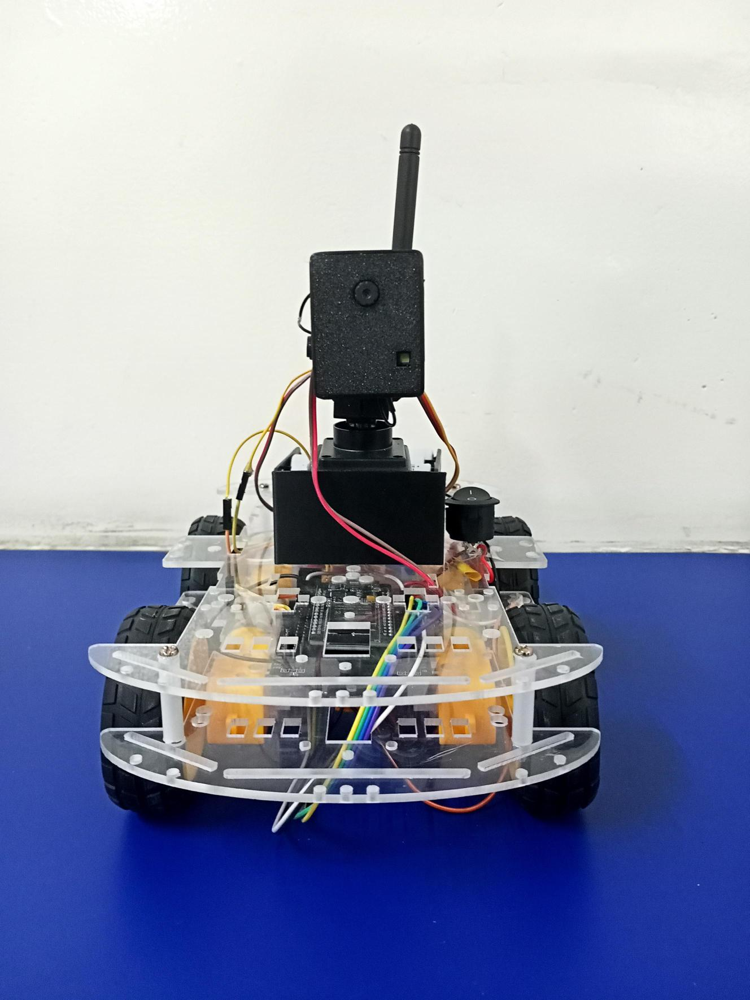
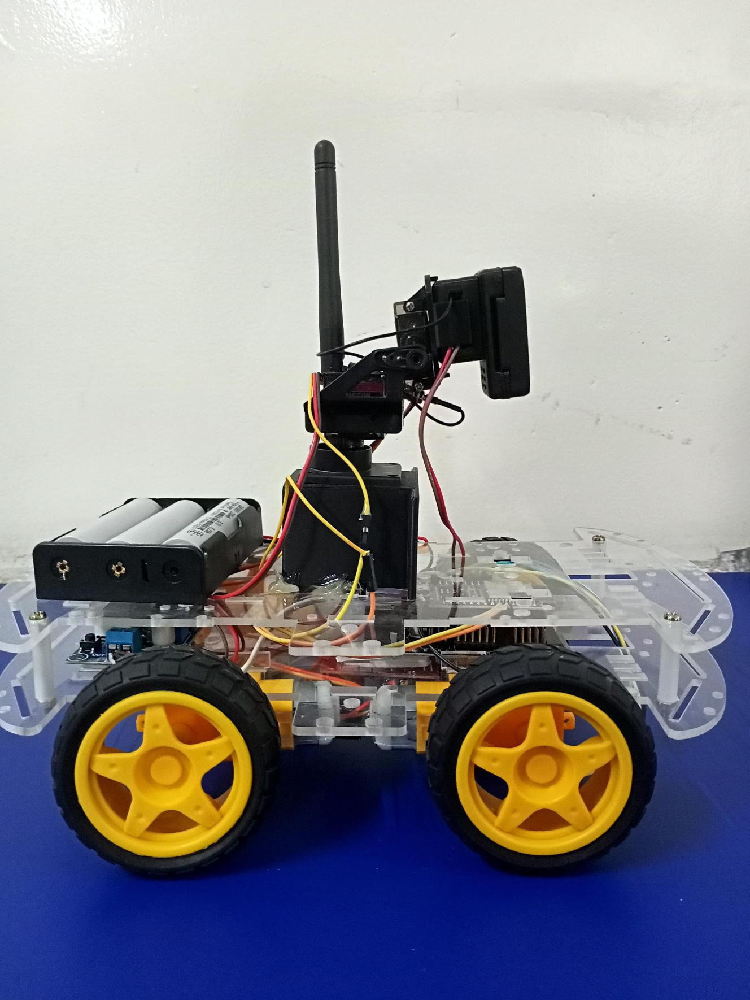
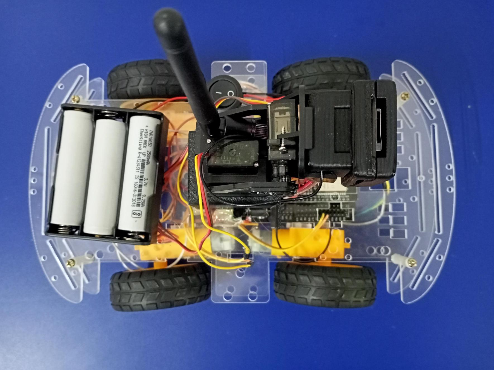
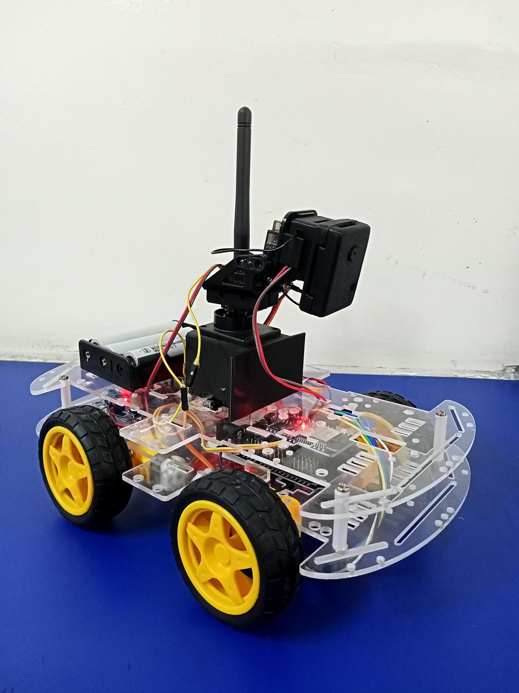
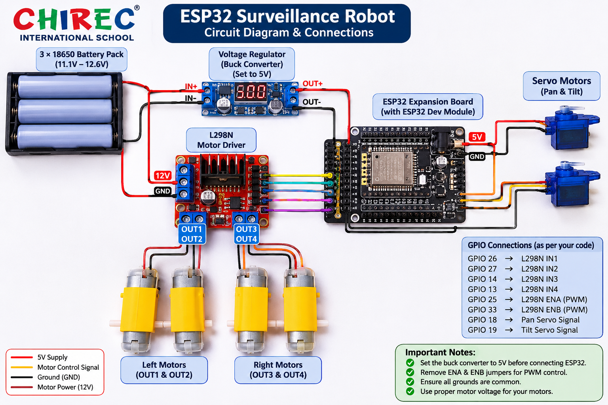

# 🤖 ESP32 Surveillance Robot

## Project Overview

An ESP32-based mobile surveillance robot developed using Arduino IDE. This project combines embedded systems, robotics, and wireless communication.

## Objectives
- Develop a mobile robotic platform.
- Implement remote robot control.
- Integrate surveillance capabilities.
- Explore ESP32-based embedded development.

## Hardware Components
- ESP32 Development Board
- Motor Driver
- DC Motors
- Robot Chassis
- Battery
- Camera Module (if applicable)

## Software and Technologies
- Arduino IDE
- Embedded C/C++
- ESP32 Board Package

## Project Working

The ESP32 acts as the main controller, managing the robot's movement and connected surveillance hardware according to the programmed instructions.

## Project Images

### Front View

### Side View

### Top View

### Working Prototype

## Circuit Diagram

## Source Code

The Arduino source code will be uploaded to the Code folder.

## Future Improvements
- Improved surveillance capabilities
- Obstacle detection
- Better wireless connectivity
- Battery optimization

## Author
Your Name
